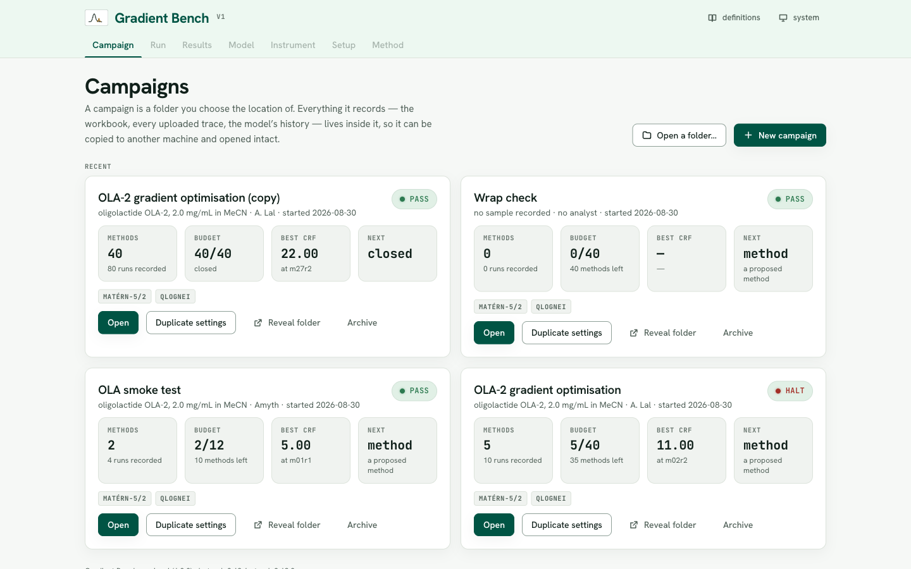
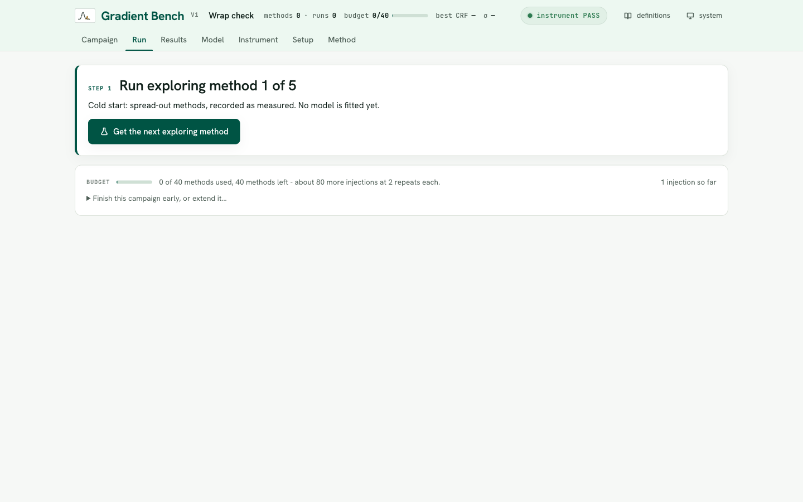
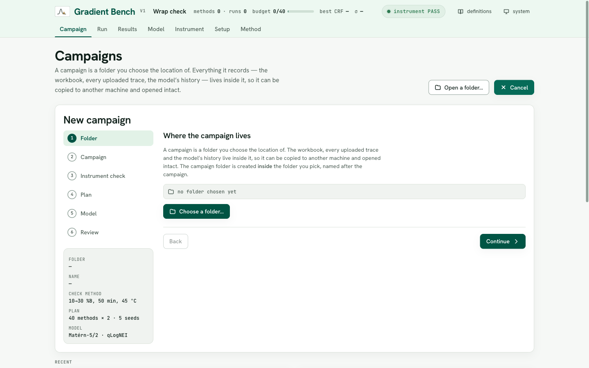
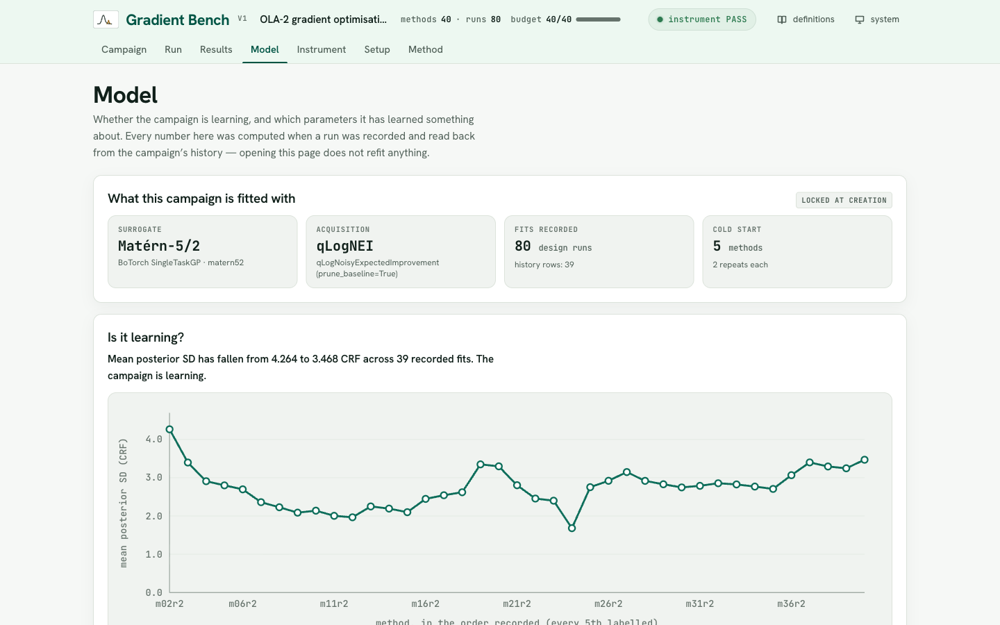
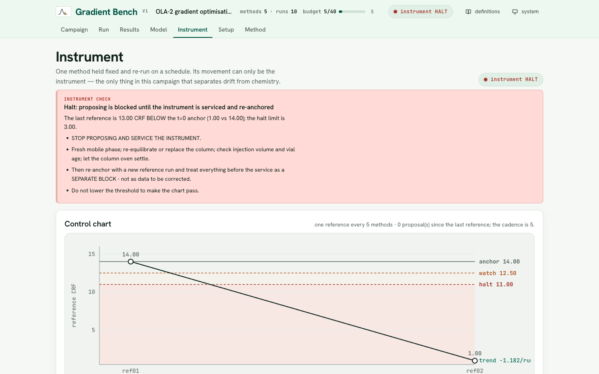
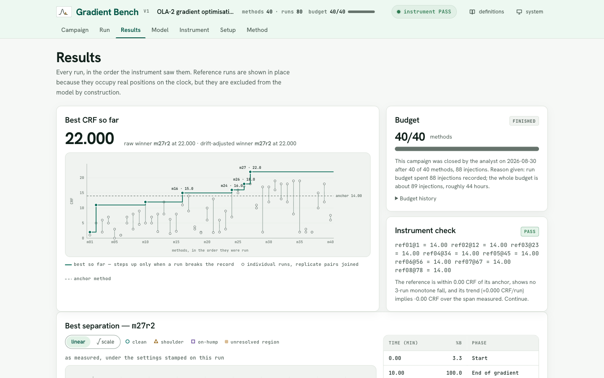

# Gradient Bench

**Closed-loop HPLC gradient method development.** The app proposes a gradient method, you
run it on the instrument, upload the trace, and confirm the peaks it found. It records the
result, refits its model, and proposes the next method — while a control chart watches the
instrument itself for drift.

It is a single Flask app with a pre-built React interface. No database, no account, no
network: nothing loads from a CDN and both fonts are vendored, because the PC next to an
HPLC often has no internet.



---

## Why it exists

Developing a gradient method is a search. Four knobs — where the gradient starts, where it
ends, how long it takes, and how hot the column runs — interact, and each candidate costs a
real injection and 15–60 minutes of instrument time. A 40-method campaign is roughly **89
injections and 44 hours of bench time**, so the search has to be sample-efficient, and every
run has to be worth its place.

Two things usually go wrong with that search:

1. **The score drifts with the instrument, not the chemistry.** A column ageing mid-campaign
   makes late methods look worse than early ones, and the optimiser dutifully learns the
   wrong lesson.
2. **Nobody can reconstruct what happened.** Three weeks later the winning method exists,
   but not the reason it won.

Gradient Bench answers both by construction. One fixed instrument-check method is re-run on
a schedule and is the only thing allowed to explain drift; and a campaign is a **folder** —
the workbook, every uploaded chromatogram, and the model's own history live inside it, so it
can be copied to another machine and opened intact.

---

## The loop

Every cycle is the same four moves. The app never shows you two things to do at once.



1. **Get the method.** The app names one: a gradient table, a column temperature, and how
   many times to inject it. Early on these are spread-out exploring methods; once the model
   is fitted, each comes with a prediction and an uncertainty.
2. **Run it** on the instrument, unchanged.
3. **Upload the trace** — the ASCII `.txt` your data system exports (time, signal).
4. **Check the peaks.** The picker classifies each peak as clean, shoulder or on-hump, and
   marks unresolved regions. You correct it if it is wrong, then record.

Recording writes the run to the workbook, re-fits the surrogate, and serves the next method.
Every fifth method the app interrupts to ask for the instrument check instead.

---

## Install

Python 3.9 or newer, and about **3 GB of disk** — almost all of it `torch`. Nothing else:
no Node, no database, no account.

**Windows.** The PC beside an HPLC usually is one, so this is the path to expect.

```powershell
git clone https://github.com/amyth-create/gradient-bench.git
cd gradient-bench
py -3 -m venv .venv
.venv\Scripts\Activate.ps1
pip install -r gradient_bench/requirements.txt
```

Use `python -m venv .venv` if `py` is not on PATH, which is usually a Microsoft Store
install rather than one from python.org. In `cmd.exe` the activation line is
`.venv\Scripts\activate.bat` instead of the `.ps1`. If PowerShell refuses to run the
activation script at all, that is the execution policy and not the install — this clears it
for the current window only, and needs no administrator:

```powershell
Set-ExecutionPolicy -Scope Process -ExecutionPolicy RemoteSigned
```

**macOS / Linux.**

```bash
git clone https://github.com/amyth-create/gradient-bench.git
cd gradient-bench
python3 -m venv .venv
source .venv/bin/activate
pip install -r gradient_bench/requirements.txt
```

Once the environment is active, every command below is the same on every platform.

`torch` and BoTorch are needed to **propose** a method, not to **record** one. Without them
the app still opens campaigns, picks peaks, scores traces and writes results — only the
*next method* button stops working.

Confirm the install before trusting it:

```bash
python -m gradient_bench.scripts.verify_install    # says what is missing and what to do
python -m pytest gradient_bench/tests -q           # expect 148 passed
```

**Keep the workbook closed while the app is recording.** A campaign's
`master_methods.xlsx` is rewritten on every recorded run, and Windows will not let a file be
replaced while another program holds it open — a campaign left open in Excel makes recording
fail with *Access is denied*. Read it whenever you like; close it before you record.

### Run it

```bash
python -m gradient_bench.api.app                   # http://127.0.0.1:5051
python -m gradient_bench.api.app --port 8000       # or pick a port
python -m gradient_bench.api.app --open /path/to/a/campaign
python -m gradient_bench.api.app --open C:\Campaigns\project-x     # Windows
```

The frontend is pre-built into `gradient_bench/api/static/`, so nothing needs Node. To
change the interface you will need it:

```bash
cd frontend && npm install && npm run build        # builds into ../gradient_bench/api/static
npm run dev                                        # dev server, proxies /api to :5051
```

---

## Your first campaign

Press **New campaign**. A six-step wizard asks for the folder, the campaign, the instrument
check, the plan, the model, and then shows you everything before it creates anything. A
summary rail on the left keeps the whole decision visible as you go.



You will be asked for six **material facts** — sample, column, mobile phase, instrument,
flow rate and detector. They are material because changing one later means the earlier and
later runs are no longer the same experiment; the app will let you do it, but it makes you
give a reason and writes that to the record.

Then the plan:

| Setting | Default | What it costs |
|---|---|---|
| Run budget | 40 methods | unique methods, not injections |
| Repeat runs per method | 2 | the only way σ can be measured directly |
| Exploring runs before the model starts | 5 | spread-out methods, recorded as measured |

The wizard states the bench-time cost of the plan — injections and hours — before anything
exists. The budget can be extended later, with a reason, on the record.

**The anchor comes first.** Nothing else is served until the instrument-check method has
been run and recorded at t = 0. Without it, every later reference is a difference from
nothing.

---

## Under the hood

### The objective

One number, maximised, frozen at version 1.0.0:

```
CRF = n_clean_peaks × (1 − hump_time_fraction)²
```

`n_clean_peaks` is how many peaks came back cleanly resolved. `hump_time_fraction` is the
share of the run sitting under an unresolved region. It is **squared on purpose**: the
penalty barely registers until a hump takes a real share of the run, then bites hard.

Only those two measurements may reach the objective. The other 15 trace-health descriptors
recorded on every run are *structurally barred* from it — an assertion runs on every
analysis and fails loudly if one of them ever reaches the score. They exist to diagnose the
instrument; they must never score the chemistry.

### The design space

Chosen at campaign creation and locked, like the kernel (version 3). Two spaces:

**Single ramp** (`ramp4`, the default) — four parameters, a box, one linear constraint:

| Parameter | Range | |
|---|---|---|
| `start_phi` | 0.02 – 0.40 | starting %B, as a fraction |
| `end_phi` | 0.10 – 1.00 | final %B |
| `duration_min` | 10 – 30 min | gradient length |
| `T` | 25 – 60 °C | column temperature |

The constraint is `end_phi >= start_phi`. The minimum span is **zero on purpose**:
`end_phi == start_phi` is an isocratic method, which is a legitimate answer the optimiser is
allowed to reach.

**Three-segment timetable** (`steps8`) — a four-node pump programme written in deltas:

| Parameter | Range | |
|---|---|---|
| `phi0` | 0.02 – 0.40 | starting %B |
| `dphi1`, `dphi2`, `dphi3` | ≥ 0 | composition step of each segment (0 = a hold) |
| `dt1`, `dt2`, `dt3` | ≥ 0 | duration of each segment (0 = an instantaneous jump) |
| `T` | 25 – 60 °C | column temperature |

The nodes are the cumulative sums, so the first node is at t = 0 and needs no parameter.
Writing the timetable in deltas puts monotonicity into the box, and **nothing else is
bounded per segment**: no minimum segment length, no largest single step. The only
constraints are on the sums — final %B at most 100, total duration at most 30 min — plus a
1-minute floor on the total duration, which is a technical necessity (the profile is drawn
on time divided by the duration) rather than a design choice. So the same setup reaches a
ramp, a step gradient, a hold-then-ramp, and two- or three-slope gradients. Cold-start seeds
come from the paper's window-relative sampler (endpoints first, interior nodes inside the
window they define), so shallow and bent profiles are as reachable as diagonal ones. The
instrument-check method stays a single ramp in either space.

Every constraint is handed to the acquisition optimiser natively rather than by rejection
sampling, so proposals are feasible by construction. Both spaces write the same eight sheet
columns (`t1 t2 t3 phi1 phi2 phi3 phi4 T`); a ramp leaves `t2 = t3 = 0`, which is how a row
says which space it came from.

### The surrogate and the acquisition

A Gaussian process over those four normalised parameters, built through BoTorch's own
constructors so its dimension-scaled LogNormal lengthscale priors are preserved. Both
choices are made **once, at campaign creation, and then locked** — a campaign fitted under
one kernel and re-fitted under another is not the same campaign.

| Surrogate | | Acquisition | |
|---|---|---|---|
| `matern52` | Matérn-5/2 ARD *(default)* | `qlognei` | log noisy expected improvement *(default)* |
| `matern32` | Matérn-3/2 | `qlogei` | log expected improvement |
| `rbf` | squared exponential | `ucb` | upper confidence bound, `beta` you set and defend |
| `wasserstein` | shape-aware × RBF(duration, T) *(v3)* | `logpi` | log probability of improvement |
| `wasserstein_matern` | shape-aware × Matérn-5/2(duration, T) *(v3)* | | |
| `wasserstein_plus` | shape-aware plus endpoints × ARD RBF *(v3)* | | |
| `wasserstein_plus_matern` | shape-aware plus endpoints × ARD Matérn-5/2 *(v3)* | | |
| `default` | whatever BoTorch installs | | |

The default pairing is qLogNEI on a Matérn-5/2 — noisy expected improvement because
replicates disagree and the incumbent is itself uncertain, and the log form because the
plain one underflows into a flat surface the optimiser cannot climb.

### The shape-aware kernels (version 3)

The coordinate kernels above say two methods are alike when their start %B values are
close *and* their end %B values are close, each on its own ruler. The shape-aware kernels
say two methods are alike when the **gradient profiles they deliver** are close: both ramps
are drawn on a normalised 0–1 time axis with %B as a fraction, and the distance between
them is the **area between the two lines** — for monotonic one-dimensional profiles, the
Wasserstein-1 distance of Boelrijk, Detlefsen, Dürholt and Haas, *Shape-aware Gaussian
process kernels for closed-loop Bayesian optimization of gradients in automated LC method
development* (ChemRxiv, 2026). A ramp from 10 to 50 %B and one from 20 to 40 %B sweep
nearly the same composition window and are 0.05 apart; 10→50 and 30→70 are 0.20 apart.

That distance is turned into a covariance as `exp(−d_W / ℓ_W)` and multiplied by a second
kernel over what the profile comparison deliberately discards. The second factor is a
squared exponential in the paper; each form is also offered with a Matérn-5/2 there, for the
reason this app prefers Matérn elsewhere:

```
wasserstein               k = exp(−d_W/ℓ_W) · RBF(duration, T)
wasserstein_matern        k = exp(−d_W/ℓ_W) · Matérn-5/2(duration, T)
wasserstein_plus          k = exp(−d_W/ℓ_W) · ARD RBF(start_phi, end_phi, duration, T)
wasserstein_plus_matern   k = exp(−d_W/ℓ_W) · ARD Matérn-5/2(start_phi, end_phi, duration, T)
```

The plus forms are the paper's *Wasserstein+*: the endpoints keep lengthscales of their
own, for samples where one endpoint dominates the separation (the paper found this on its
experimental datasets, where many analytes eluted at low %B). In the three-segment space the
endpoint features are derived from the timetable (`end_phi = phi0 + Σ dphi`,
`duration = Σ dt`) inside the kernel, so the same four feature names appear in either space.
All forms carry BoTorch's own priors — `ℓ_W` under the dimension-scaled LogNormal with D = 1
and the same `GreaterThan(0.025)` constraint, the second factor built by BoTorch's
constructor — and the Model tab reports a **shape** lengthscale, in units of area between
profiles, beside the others.

**Where it earns its keep.** The paper's headline case is *timetable redundancy*: a
multi-node pump programme can write one profile many ways (slide a node along the line
joining its neighbours), and a coordinate kernel wastes budget learning that those
timetables are the same experiment. In the three-segment space the Wasserstein distance
between two such timetables is exactly zero, so the shape-aware kernels are the natural
pairing there. In the single-ramp space there is no such redundancy, and the shape-aware
kernels only change what *nearby* means. They are options, not the default, and are not yet
validated on this bench; the Model tab's learning curve is how to find out. The distance is
implemented for piecewise-linear profiles in general (`core/shape.py`).

**What has been checked so far (2026-09-15).** On a smooth synthetic response with 0.5 CRF
noise, leave-one-out R² over five random designs was, for Matérn-5/2 / Wasserstein /
Wasserstein+: −0.17 / −0.36 / −0.13 at 8 runs, +0.26 / +0.01 / +0.32 at 12, +0.52 / +0.39 /
+0.53 at 20 and +0.81 / +0.68 / +0.83 at 30, with the shape lengthscale settling near 0.16.
So the kernel learns, and the plus form is the one to reach for first. On the bundled
15-method corpus every kernel has negative leave-one-out R² and the shape lengthscale
collapses to its floor — the marginal likelihood genuinely prefers that on data whose CRF
is an integer peak count with a fallback σ of 1 — which says the corpus is too small and
too noisy to rank kernels, not that either is wrong.

BoTorch is pinned to `>=0.18,<0.19` deliberately: its *default* kernel and priors changed
between releases. The resolved versions of every library are written into each campaign's
Config sheet.

### Noise, and why replicates are not optional

Two runs at identical settings differ only by noise. That is the only direct measurement of
σ available, which is why the default plan injects each method twice. The pooled replicate σ
is converted and installed as the model's noise floor, so the GP is never told the data is
cleaner than the instrument actually is.

The Model tab reports what it found and does not flatter it — including `floor_z`, which
says how much of the observed spread is just noise. When differences between methods are
marginal, it says so.



### The peak picker

A vendored, self-contained picker (`hplc_picker` 3.0.0) that defines what a peak *is*:
baseline correction, a prominence gate set as signal-to-noise × the noise estimate, then
classification into clean / shoulder / on-hump, plus detection of unresolved regions.

Three thresholds are exposed — the S/N gate, the hump floor ratio, and the minimum hump span
— each stating what raising and lowering it does. You can also drag across the trace to draw
an unresolved region by hand, which replaces automatic detection for that run.

Changing the picker campaign-wide **re-scores every stored trace**, so the CRF column keeps
meaning one thing for the life of the campaign.

### Drift, and the control chart

One method held fixed, re-run every fifth method. Its movement can only be the instrument —
that is the entire reason it exists.



Measured against the t = 0 anchor: **WATCH** at 1.5 CRF below it, **HALT** at 3.0 below, or
at three consecutive falls. On a halt the app stops proposing and tells you to service the
instrument and re-anchor, treating everything before the service as a separate block — not
as data to be corrected.

Six diagnostic channels (peak width, tailing, retention, signal and area, baseline and
noise, acquisition) are read from the reference runs only, and each reading is offered as a
hypothesis, not a diagnosis. One of them detects that the *acquisition itself* changed — a
different run length or sampling rate — which means the references are no longer measuring
the same thing and every other panel is reading across a discontinuity.

Drift-adjusted scores are available but **off by default**: adjusting assumes the drift is
reversible, and nothing can check that. It never changes what the model is fitted to. The GP
always sees raw scores.

---

## Reading the results

The Results tab is the ledger: every run in the order the instrument saw them, with
reference runs shown in place — they occupy real positions on the clock — but excluded from
the model by construction.



The record line steps up only when a run actually breaks the record, so the flat stretches
are visible: *how long since the last improvement* is exactly the evidence the "extend or
finish" decision needs.

Everything exports — a workbook and a PDF report, written into the campaign folder. The
**Method** tab assembles a full methods statement from the running code and the campaign's
own workbook, not from a page maintained by hand, and prints with its own masthead.

---

## What is in here

```
gradient_bench/          the app
  core/                  the science: space, optimiser, picker, CRF, drift, uncertainty
    space.py             the design spaces: ramp4 (4 parameters) and steps8 (three segments in deltas)
    optimiser.py         SURROGATE_OPTIONS, ACQUISITION_OPTIONS, the GP fit
    shape.py             the shape-aware kernels: Wasserstein-1 between gradient profiles (v3)
    hplc_picker.py       the only copy of the peak picker — it defines what a peak is
    crf.py               the objective, frozen
    drift.py             the control chart and its limits
  store/campaign.py      a campaign is a folder; the workbook is its record
  api/app.py             the Flask API and the pre-built frontend
  scripts/               verify_install, replay_corpus (headless)
  tests/                 148 tests, including golden files
frontend/                React source (Vite): tabs/, components/, styles/
testdata/                21 real chromatograms and their sheet
docs/screenshots/        the images in this README
```

`gradient_bench/core/hplc_picker.py` is the **only** copy of the picker; `hplc_picker.py` in
the root is a three-line shim so `import hplc_picker` keeps working. If you change the
picker, edit the copy in `core/` and re-run the tests.

## Tests

```bash
python -m pytest gradient_bench/tests -q                    # 148 passed
python -m gradient_bench.scripts.replay_corpus --trace-dir testdata/traces
```

`testdata/` holds real chromatograms and their sheet, so the golden-file tests and the
headless replay run straight out of this folder with nothing else installed.
